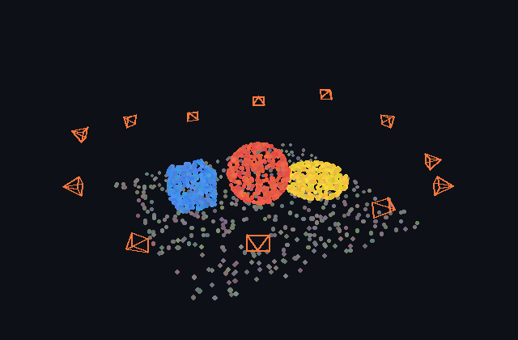
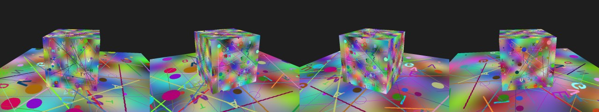
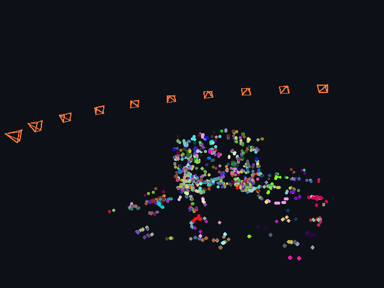
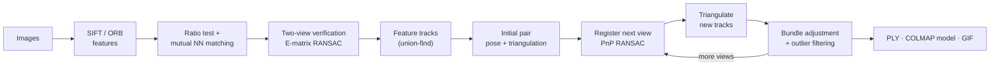
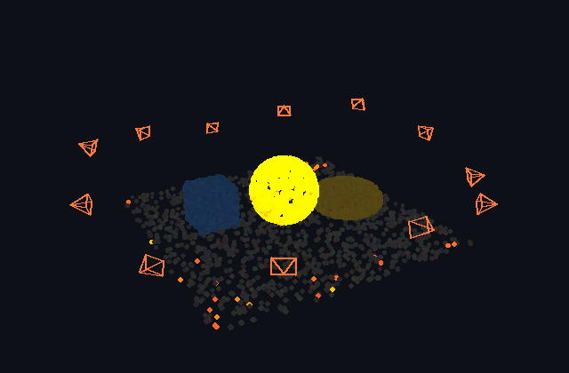

<div align="center">

# Structura

### Incremental Structure-from-Motion and Point-Cloud Processing, from First Principles

[Dang Truong Minh Le](https://github.com/dangaura-tech)

[](https://github.com/dangaura-tech/structura/actions/workflows/ci.yml)




<sub>Sparse reconstruction of a synthetic scene (sphere, box, torus, ground plane) from 12 views
with 10 % outlier matches. The orange wireframes are the recovered camera poses. The GIF is
rendered by the built-in software renderer: <code>python tools/demo_synthetic.py --gif assets/sfm_turntable.gif</code></sub>

### From pixels to cameras and points





<sub>Full image-based run: SIFT features → ratio-test matching → essential-matrix verification →
incremental SfM on 10 photo-like renders of a textured box on a textured floor.
Reproduce with <code>python tools/demo_images.py --assets assets</code>.</sub>

</div>

---

**Structura** turns a set of overlapping photos into camera poses and a coloured 3-D
point cloud. It implements the classic incremental SfM pipeline used by COLMAP and
OpenMVG in readable NumPy / SciPy / OpenCV, so every step can be inspected, modified and
unit-tested:

| Stage | Implementation |
|---|---|
| Features & matching | SIFT / ORB, Lowe ratio test, mutual nearest-neighbour check |
| Geometric verification | 5-point essential matrix + RANSAC per image pair |
| Feature tracks | union-find over verified matches; inconsistent tracks rejected |
| Initialisation | pair scored by inliers × triangulation-angle prior, cheirality-checked pose |
| Registration | PnP (EPnP + RANSAC) with iterative refinement, best-connected image first |
| Triangulation | multi-view DLT with widest-baseline partner, angle / depth / reprojection filters |
| Bundle adjustment | sparse Jacobian trust-region least squares, two-stage robust (Huber) loss |
| Point clouds | voxel downsampling, PCA normals, statistical outliers, point-to-point / point-to-plane ICP, RANSAC planes, Chamfer distance |
| I/O & visualisation | binary/ASCII PLY, COLMAP text model export, turntable GIF renderer |
| Language-driven 3-D queries | dense CLIP features (MaskCLIP), multi-view fusion into points, LERF-style relevance, open-vocabulary segmentation |

## Pipeline



## Installation

```bash
git clone https://github.com/dangaura-tech/structura.git
cd structura
pip install -e ".[dev]"
```

## Usage

**Reconstruct your own photos.** Walk around an object and take 15–50 overlapping photos.

```bash
python tools/reconstruct.py --images path/to/photos --out output/my_scene --gif
# -> output/my_scene/points.ply, output/my_scene/colmap/*.txt, output/my_scene/turntable.gif
```

The sparse model can be opened in [MeshLab](https://www.meshlab.net/) (`points.ply`) or
imported into the COLMAP GUI (`File → Import model`) for dense reconstruction.

**Image-based demo** (renders textured views, then runs the full pipeline from pixels):

```bash
python tools/demo_images.py --views 10 --out output/demo_images
```

**Synthetic benchmark with exact ground truth** (no data needed):

```bash
python tools/demo_synthetic.py --cameras 12 --noise 0.5 --outlier-ratio 0.1 --gif demo.gif
```

It reports registered views, reprojection error, camera position / rotation error and the
Chamfer distance to the true geometry, after a similarity alignment (Umeyama).

**Align two point clouds with ICP:**

```bash
python tools/register.py scan_a.ply scan_b.ply --out a_aligned.ply --voxel 0.02 --point-to-plane
```

**Python API:**

```python
from structura import IncrementalSfM, Intrinsics
from structura.features import detect, match_all

feats = {i: detect(img) for i, img in enumerate(images)}
intr = {i: Intrinsics.from_image_size(w, h) for i in feats}
rec = IncrementalSfM(intr, {i: f.keypoints for i, f in feats.items()}, match_all(feats)).run()
print(len(rec.cameras), "cameras,", rec.num_points, "points")
```

## Language-driven 3-D queries

<div align="center">


<sub>Query <i>"the red sphere"</i> on the synthetic reconstruction. This demo uses the built-in
<b>mock colour encoder</b> (no pretrained weights), so it only understands colour words.
With OpenCLIP the same pipeline answers free-form queries. Reproduce with
<code>python tools/demo_semantics.py --gif assets/query3d_demo.gif</code>.</sub>
</div>

Structura can attach **vision-language features** to a reconstruction and answer text
queries in 3-D, with no training:

1. **Dense CLIP features.** For each registered photo, a CLIP ViT produces a per-patch
   embedding map with the MaskCLIP trick: in the last block the value embeddings of the
   patch tokens go through the output projection, `ln_post` and the image projection,
   which keeps them in CLIP's joint image-text space. Positional embeddings are
   interpolated, so any resolution works.
2. **Multi-view fusion.** Each 3-D point is projected into the images that observed it (its
   SfM track, or a z-buffer for points without one). The feature map is sampled
   bilinearly, and the L2-normalised samples are averaged into one embedding per point.
3. **Querying.** Relevance follows LERF: for each canonical negative (*object, things,
   stuff, texture*) take the pairwise softmax of the query vs. negative similarity, then the
   minimum over negatives. `--labels` instead assigns every point to its most similar label.

```bash
pip install -e ".[clip]"                                     # torch + open_clip
python tools/reconstruct.py --images photos/ --out output/room   # also writes reconstruction.npz
python tools/query3d.py --recon output/room/reconstruction.npz --query "a wooden chair" "a plant" --gif
python tools/query3d.py --recon output/room/reconstruction.npz --labels chair table floor wall plant
```

The first OpenCLIP run downloads the weights (default `ViT-B-16` / `laion2b_s34b_b88k`;
choose others with `--model` / `--pretrained`). Any model exposing
`encode_image_dense(image) -> (h, w, D)` and `encode_text(texts) -> (T, D)` can be plugged
in through the `ImageTextEncoder` protocol.

## Design notes

* **Why verify before building tracks?** A single outlier match can chain two unrelated
  keypoints into one track. The track then contains two observations in the same image and
  is discarded. Two-view RANSAC first keeps tracks long and consistent.
* **Gauge.** The first camera is fixed during bundle adjustment. The scale is set by the
  unit-norm baseline of the initial pair, so reconstructions are metric only up to a
  similarity transform.
* **Robust BA.** When the initialisation is poor, every residual is large and a robust loss
  with a small scale treats them all as outliers. Stage 1 therefore adapts the Huber scale
  to the median residual, and stage 2 switches to the target scale.

More details are in [`docs/design.md`](docs/design.md).

## Repository structure

```
structura/
├── camera.py          # pinhole model, poses, look-at, rotations
├── features.py        # SIFT/ORB detection and matching
├── geometry.py        # DLT triangulation, essential matrix, PnP, Umeyama
├── tracks.py          # union-find feature tracks
├── bundle.py          # sparse bundle adjustment
├── reconstruction.py  # incremental SfM driver
├── pointcloud.py      # voxels, normals, ICP, RANSAC planes, Chamfer
├── io.py              # PLY, COLMAP text export
├── render.py          # NumPy + Pillow point-cloud renderer, turntable GIFs
├── semantics/         # CLIP dense features (MaskCLIP), multi-view fusion, text queries
└── synthetic.py       # multi-view scenes with exact ground truth
tools/                 # reconstruct / query3d / demo_images / demo_synthetic / demo_semantics / register
assets/                # README demo media (generated by the demo scripts)
tests/                 # geometry, SfM, point-cloud tests
```

## Roadmap

- [ ] Radial distortion in the camera model and BA
- [ ] Vocabulary-tree image retrieval for large unordered collections
- [ ] Multi-view stereo densification (plane sweep)
- [ ] Learned features (SuperPoint / LightGlue) as an optional front-end

## References

- Hartley & Zisserman, *Multiple View Geometry in Computer Vision*, 2004
- Schönberger & Frahm, *Structure-from-Motion Revisited* (COLMAP), CVPR 2016
- Nistér, *An Efficient Solution to the Five-Point Relative Pose Problem*, TPAMI 2004
- Lepetit et al., *EPnP*, IJCV 2009 · Triggs et al., *Bundle Adjustment - A Modern Synthesis*, 1999
- Radford et al., *CLIP*, ICML 2021 · Zhou et al., *MaskCLIP: Extract Free Dense Labels from CLIP*, ECCV 2022
- Kerr et al., *LERF: Language Embedded Radiance Fields*, ICCV 2023 · Peng et al., *OpenScene*, CVPR 2023
- Besl & McKay, *ICP*, 1992 · Chen & Medioni, *point-to-plane ICP*, 1992 · Umeyama, TPAMI 1991

## License

MIT © Dang Truong Minh Le
